<div align="center">


# JAAL · जाल

### Scam rings, caught before you pay.

**An ambient scam shield for India, built on a TigerGraph fraud graph.**
JAAL watches the messages, links and UPI IDs already on your laptop and phone. The moment one belongs to a
ring that other people have reported, it tells you, on top of whatever you are looking at.
No account. No contacts. No KYC.

<br>


<br>


[Live demo flow](#-run-it-in-60-seconds) ·
[Why TigerGraph](#-why-a-graph-and-why-tigergraph) ·
[The six queries](#-six-questions-only-a-graph-answers) ·
[Benchmark](#-the-honest-benchmark) ·
[Screens](#-screens) ·
[Architecture](#-architecture)

<br>

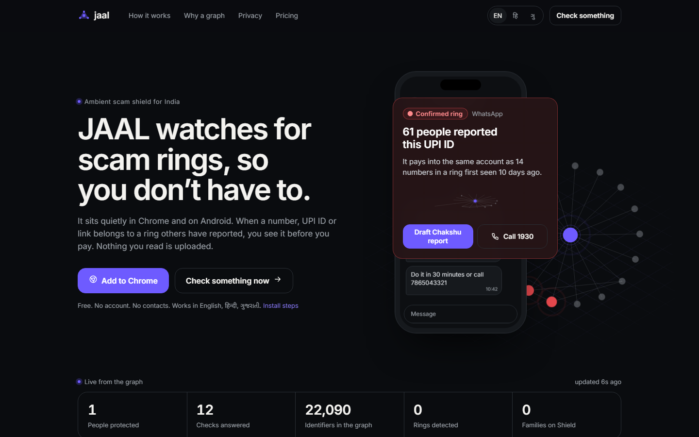

</div>

---

> **Scammers rotate phone numbers in days. They keep payout accounts for months.**
> The link between the two is the only durable signal, and only a graph can follow it.

## 🕸 The problem

A scam in India is never one bad number. It is a **ring**: 40 SIMs, 6 UPI handles, 2 mule accounts, a
lookalike domain, an APK and one script translated three times, moving from Jamtara to Pune to Bengaluru in
a fortnight. Blocklists of numbers are always a week late, because the number is the part that changes.

So the question *"is this UPI ID dangerous?"* is really *"how close is it to something already
corroborated?"*. That is a **traversal**, and JAAL answers it in one graph query, for every check, from
every device. Every check also writes back, so the graph gets denser on the same path that serves the user.

<div align="center">
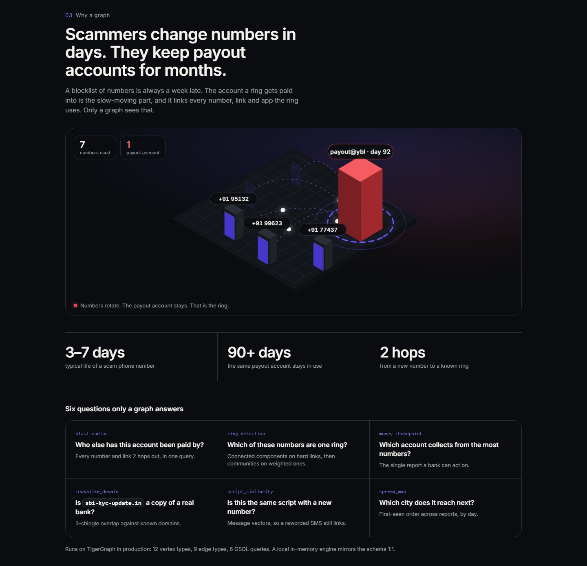
</div>

---

## 🐯 Why a graph, and why TigerGraph

JAAL's engine is **one shared fraud graph on TigerGraph 4.x / Savanna**. Everything in
[`tigergraph/`](tigergraph/) is built for it: the schema, the GSQL queries, GDS ring detection, loaders,
Savanna setup and a measured Postgres comparison.

| What JAAL needs | What TigerGraph gives it | Where |
|---|---|---|
| "How far is this from a confirmed ring?" in one round trip | Multi-hop `WHILE` traversal with `OrAccum @visited`, `MinAccum @hop`, in-query decay | [`blast_radius.gsql`](tigergraph/queries/blast_radius.gsql) |
| Group thousands of identifiers into rings | GDS `tg_wcc` (hard links) then `tg_louvain` (decay-weighted) | [`gds/`](tigergraph/gds/), [`refresh-rings.mjs`](tigergraph/load/refresh-rings.mjs) |
| Find the mule account a ring is paid into | **In-query PageRank** over a heterogeneous `PAYS_TO` subgraph | [`money_chokepoint.gsql`](tigergraph/queries/money_chokepoint.gsql) |
| Catch a reworded SMS with brand-new numbers | **Hybrid TigerVector search**: graph-filtered candidate set + `vectorSearch()` on a 256-d COSINE HNSW attribute | [`script_similarity.gsql`](tigergraph/queries/script_similarity.gsql) |
| Track how a ring moves across cities | `NEXT` temporal edges + `MapAccum<STRING, MinAccum<DATETIME>>` | [`spread_map.gsql`](tigergraph/queries/spread_map.gsql) |
| Resist poisoning by fake reports | Corroboration rule inside the graph: ≥ 3 reports from ≥ 2 independent reporter clusters | [`materialize_campaigns.gsql`](tigergraph/queries/materialize_campaigns.gsql) |

In SQL, community detection, PageRank over mixed vertex types and graph-filtered vector search are each an
export to another system. In GSQL they run **over the same edges, in the same store, in one call**.

### Schema: 12 vertex types, 10 edge types

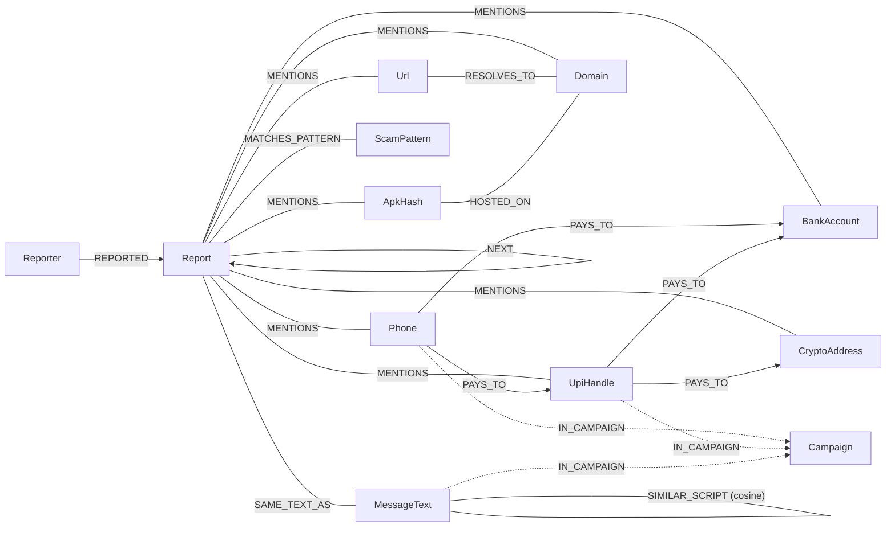

- **Primary ids are canonical keys** from [`shared/extract.js`](shared/extract.js): `upi:refund.desk@ybl`,
  `phone:+919812300001`, `campaign:<id>`. The server never translates ids.
- **Every vertex shares** `value, state, report_count, first_seen, last_seen, trust, city, wcc_id,
  community_id`, so heterogeneous traversals read `v.state` without per-type branching.
- **Every edge carries** `ts, weight, decayed`. Weights decay with a **21-day half-life**; queries are
  time-windowed (default 90 days).
- **`MessageText.embedding`** is a `VECTOR ATTRIBUTE (DIMENSION=256, METRIC="COSINE")` added by a global
  schema-change job (TigerGraph 4.2+).
- **Poisoning defences live in the graph.** `REPORTED` is never a community edge, so one reporter cannot glue
  rings together. Disputed reports are excluded everywhere.

### Ring detection pipeline (batch, every ~15 min)

```
refresh_decay ─▶ tg_wcc ─▶ tg_louvain ─▶ materialize_campaigns ─▶ link_next
 21-day decay    entities    campaigns    corroboration rule        NEXT chains
 on e.decayed    (wcc_id)    (community)  → Campaign "ring:<key>"   for spread_map
```

---

## ❓ Six questions only a graph answers

| # | Query | The question | GSQL doing the work |
|:-:|---|---|---|
| 1 | `blast_radius(id_key, window_days)` | What is within 2 identifier hops, and how far is the nearest confirmed node? | `WHILE` BFS, `OrAccum @visited`, decay on `e.ts`, `HeapAccum` top-50, hub guard |
| 2 | `ring_of(id_key)` | Which ring is this in? Draw it (≤ 40 nodes). | `tg_wcc` + `tg_louvain` membership, BFS inside the community, `SetAccum @via` projection |
| 3 | `money_chokepoint(k)` | Which account do the most distinct phones pay into? | `SetAccum<VERTEX>` over `reverse_PAYS_TO`, in-query PageRank |
| 4 | `lookalike_domain(domain)` | Is `sbi-kyc-update.in` a near-copy of a reported domain? | 3-shingle Jaccard with `substr` / `instr` in `FOREACH ... RANGE` |
| 5 | `script_similarity(text_key, k)` | Is this the same script as a confirmed ring, with new numbers? | Hybrid TigerVector `vectorSearch()` over a graph-derived `candidate_set` |
| 6 | `spread_map(campaign_id)` | Which city does it reach next? | `NEXT` edges, `MapAccum` first sighting per city |

Full return shapes, ids and the REST++ contract: [`tigergraph/README.md`](tigergraph/README.md).
Step-by-step Savanna setup (≈ 20 min): [`tigergraph/setup.md`](tigergraph/setup.md).

```bash
# server/.env — switch the live engine to TigerGraph
GRAPH_BACKEND=tigergraph
TG_HOST=https://<id>.i.tgcloud.io
TG_GRAPH=JAAL
TG_TOKEN=<token>        # or TG_SECRET and the server mints tokens itself
```

`GET /api/health` then reports `integrations.tigergraph.mode: "live"` and every verdict carries
`engine: "tigergraph"`. If TigerGraph is unreachable, the in-memory engine (a 1:1 mirror of the schema)
answers instead, so a check never blocks on the network.

---

## 📊 The honest benchmark

One question, three engines, same data, same seeds, same answer verified: *blast radius from one identifier,
k edge hops, 90-day window.* Real runs from [`tigergraph/bench/`](tigergraph/bench/) on 30 Oct 2026
(i5-12500H, 16 GB, PostgreSQL 18.4, Node 22). Nothing typed by hand.

| dataset | hops | Postgres p50 | Postgres p95 | in-memory BFS p95 | avg reached |
|---|:-:|--:|--:|--:|--:|
| 1M edges, sparse | 4 | 0.30 ms | 0.60 ms | 0.014 ms | 19.6 |
| 1M edges, sparse | 8 | 0.79 ms | 1.97 ms | 0.025 ms | 37.5 |
| 1M edges, **dense** | 4 | 0.42 ms | 0.93 ms | 0.036 ms | 33.3 |
| 1M edges, **dense** | 8 | 2.47 ms | **308.7 ms** | 0.32 ms | 641 |
| 1M edges, **dense** | 12 | 24.0 ms | **316.0 ms** | 8.8 ms | 11,275 |

**What it says:** on sparse data at production depth, a well-indexed Postgres is fine, and we say so. It
degrades on dense, deep traversals because a `WITH RECURSIVE ... UNION` CTE has no visited set that carries
across iterations, so a vertex reachable at several depths is expanded again at each one. GSQL has one:
`OrAccum @visited`. The bigger case for TigerGraph is the other five queries, which SQL cannot run in place.

> **TigerGraph rows are not in the table yet.** They come only from `run-tigergraph.mjs` against a live
> Savanna workspace, and no latency claim is made until then.

---

## 🖼 Screens

<table>
<tr>
<td width="50%">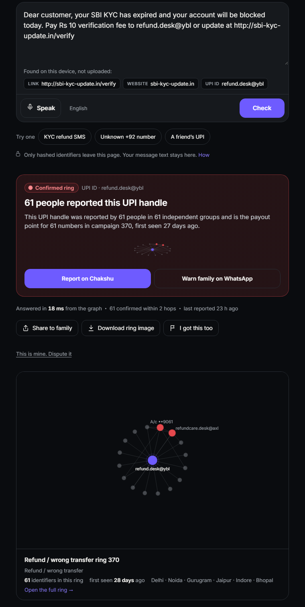</td>
<td width="50%">

**Check before you pay** · `/check.html`

Paste a message. Identifiers are extracted **on the page** (link, website, UPI ID), only hashes leave it,
and the graph answers in milliseconds:

- **Confirmed ring** · *61 people reported this UPI handle*
- one plain sentence with numbers, never "fraud"
- the ring drawn from the same query (hop 0 / 1 / 2)
- a Chakshu draft, 1930 one tap away, *Warn family on WhatsApp*
- a dispute link on every verdict

</td>
</tr>
</table>

| How it works | The moment of payment |
|---|---|
| 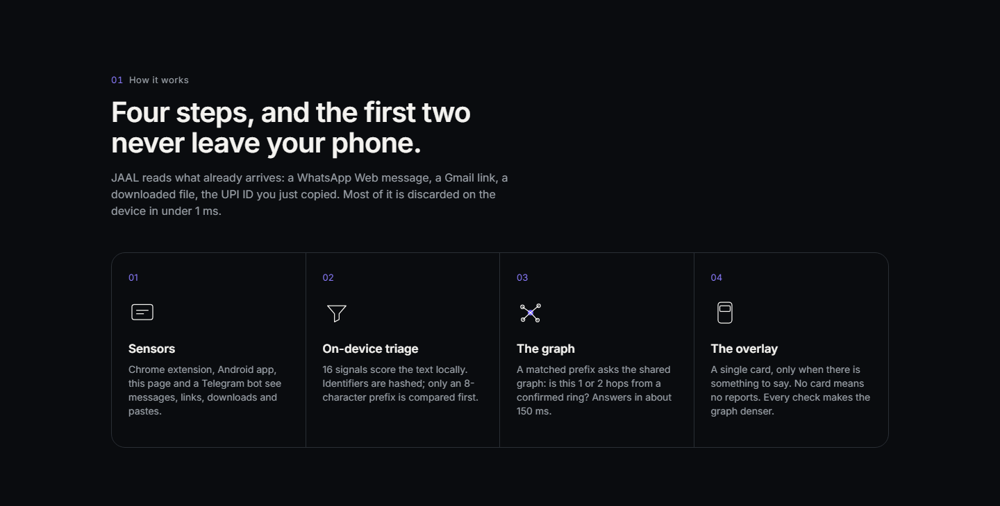 | 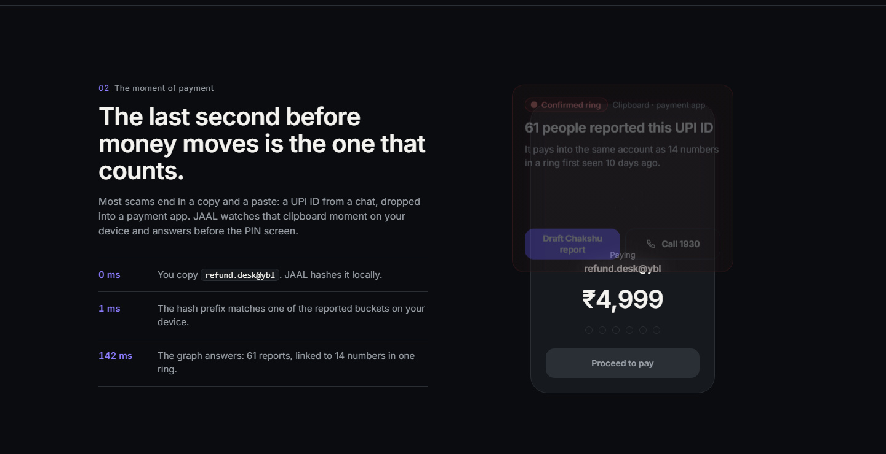 |
| **Ring of the day** | **Ring page** · `/ring.html` |
| 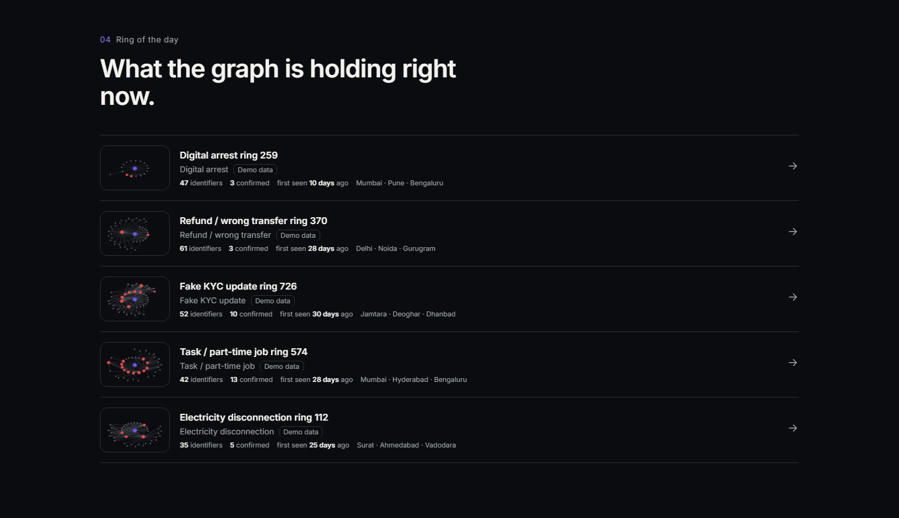 | 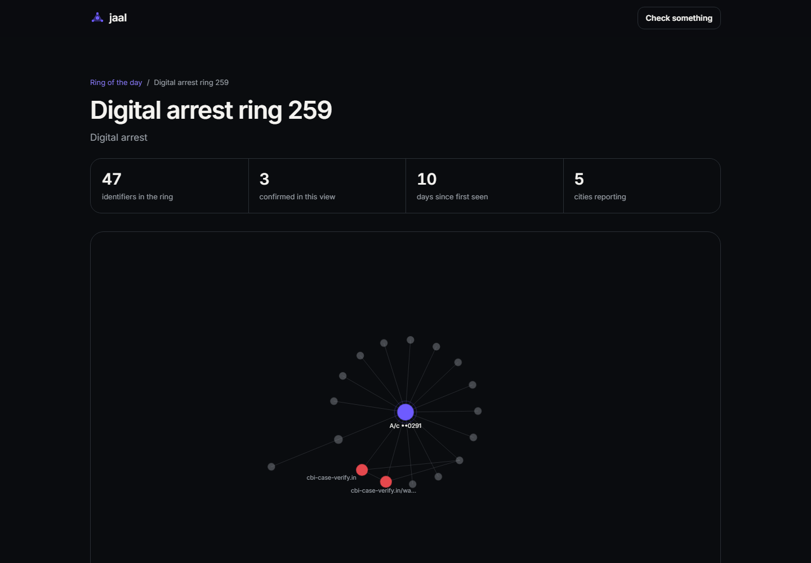 |
| **Check page** | **Guardian (family alerts)** · `/guardian.html` |
| 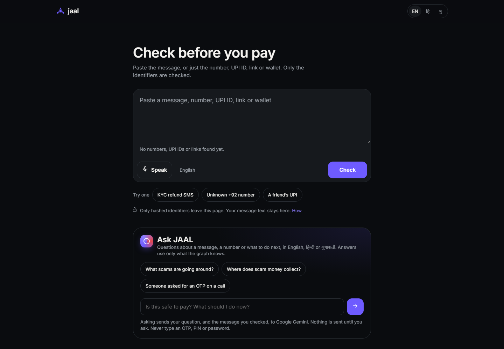 | 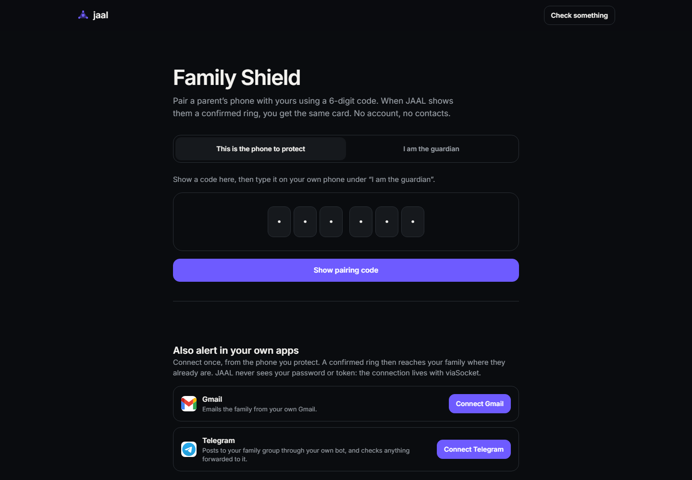 |

<details>
<summary><b>Full landing page</b> (click to expand)</summary>
<br>
<div align="center">
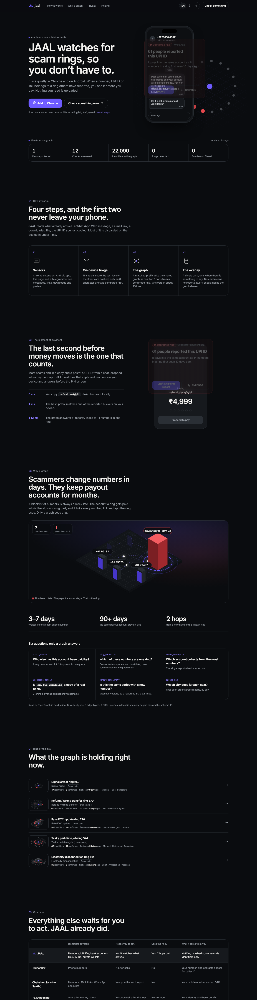
&nbsp;&nbsp;
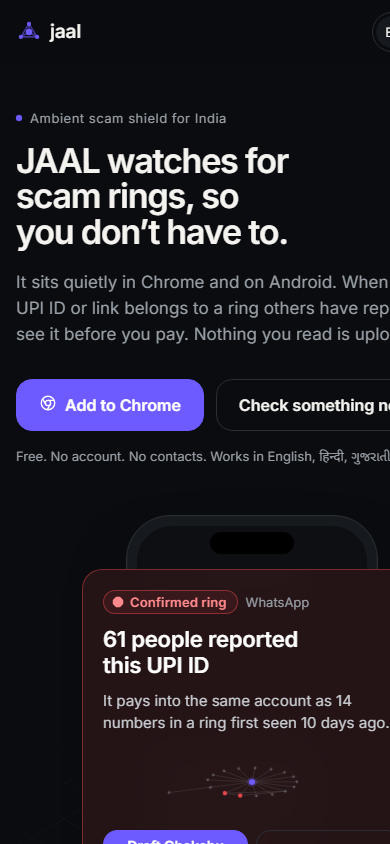
</div>
</details>

---

## ⚙️ How it works

```
 ┌───────────── on the device ─────────────┐        ┌────────────── shared ──────────────┐
 │                                         │        │                                    │
 │  1 SENSORS          2 TRIAGE            │ prefix │  3 THE GRAPH (TigerGraph)          │
 │  Chrome extension   extract.js pulls    │  hit   │  blast_radius → ring_of →          │
 │  Android app        phones, UPI, links, ├───────▶│  verdict: clear / reported /       │
 │  web check, bot     APKs, wallets;      │        │           confirmed ring           │
 │                     ~1 ms, 16 signals   │◀───────┤  + ring + reason + next step       │
 │  4 THE OVERLAY      8-hex SHA-256       │verdict │                                    │
 │  one card, only     prefix list held    │        │  5 every check writes back ──▶     │
 │  when there is      locally (Safe       │        │    graph gets denser               │
 │  something to say   Browsing pattern)   │        │                                    │
 └─────────────────────────────────────────┘        └────────────────────────────────────┘
```

1. **Sensors.** Chrome MV3 extension (WhatsApp Web, Telegram Web, Gmail, paste events, remote-access
   downloads, site checks) and the Android app (notification listener, overlay, call screening, clipboard
   tile). No AccessibilityService.
2. **On-device triage.** [`shared/extract.js`](shared/extract.js) extracts identifiers and scores the text in
   about a millisecond. Almost everything is discarded on the device.
3. **Private lookup.** The device holds 8-hex SHA-256 prefixes of reported identifiers and only asks the
   server on a prefix hit or a strong signal.
4. **The graph** answers with one of three states, never a binary fraud label:

   | state | meaning |
   |---|---|
   | ⚪ `clear` | no signal, so **no card at all** |
   | 🟠 `reported` | ≥ 1 report touches the identifier or a 1-hop neighbour |
   | 🔴 `confirmed` | ≥ 3 reports from ≥ 2 independent reporter clusters, or a public-feed match, above a trust threshold |

5. **Every check writes back**, so the graph is denser after each use.

---

## 🚀 Run it in 60 seconds

Zero secrets needed. The server runs the in-memory engine, which mirrors the TigerGraph schema 1:1.

```bash
cd server && npm install && npm run seed && npm start
```

Open **http://localhost:8787**, then try **http://localhost:8787/check.html?example=kyc** for a confirmed ring.

| Try it | How |
|---|---|
| 🌐 Web check, no install | `/check.html` |
| 🧩 Chrome extension | `web/extension.zip` → `chrome://extensions` → Developer mode → Load unpacked. Guide: `/extension.html` |
| 📱 Android APK (sideload) | `web/jaal.apk` · source in [`android/`](android/) |
| 🤖 Public read-only MCP server | [`mcp/README.md`](mcp/README.md): `check_identifier`, `get_ring`, `top_rings`, `money_chokepoints`, `spread_map`, `graph_stats` |
| 🐯 TigerGraph | [`tigergraph/setup.md`](tigergraph/setup.md) |
| ☁️ Deploy (Render + Vercel) | [`DEPLOY.md`](DEPLOY.md) |

```bash
npm test --prefix server        # API, graph, verdict, payment-safety and feed tests
npm test --prefix extension     # extractor + build tests
```

---

## 🏗 Architecture

```
jaal/
├── shared/        extract.js (identifier extraction + triage, UMD), ring.js (ring renderer), tokens.css
├── server/        Node 22 API · in-memory graph engine (Louvain, similarity) · TigerGraph adapter · integrations
├── tigergraph/    schema.gsql · queries/ · gds/ · loading_job.gsql · load/ · bench/ · setup.md
├── web/           landing, check, ring, guardian, privacy pages (no framework)
├── extension/     Chrome MV3: content watchers, overlay, popup, side panel, demo pages
├── android/       Kotlin: notification listener, overlay, call screening, clipboard tile, guardian
├── mcp/           public read-only MCP server (stdio + Streamable HTTP)
├── api/           Vercel serverless entry
└── SPEC.md        the contract every part builds against
```

| Layer | Tech |
|---|---|
| Graph | **TigerGraph 4.x / Savanna**, GSQL, GDS (`tg_wcc`, `tg_louvain`), TigerVector · in-memory mirror engine |
| API | Node 22, Express, REST++ adapter with memory fallback |
| Clients | Chrome MV3 extension, Kotlin Android app, static web, MCP server |
| Optional integrations | Dodo Payments (family plan), viaSocket (Chakshu draft → email / sheet / Slack), Cake Wallet (XMR/BTC), Wispr Flow (voice), Gemini / Claude (plain-language reason, never blocks a verdict) |
| Open feeds | OpenPhish, MetaMask phishing list, ScamSniffer |

Every external service is optional and switches on by env var (see [`server/.env.example`](server/.env.example));
its current mode shows at `/api/health`.

### API at a glance

```
POST /api/check              text or identifiers → Verdict (state, headline, reason, ring, actions)
POST /api/report             add a report; returns the updated verdict
POST /api/dispute            demote pending review
GET  /api/ring/:campaignId   campaign + ring (≤ 40 nodes)
GET  /api/rings/top          ring of the day
GET  /api/chokepoints        money chokepoints
GET  /api/spread/:campaignId city spread over time
GET  /api/prefixes           8-hex hash prefixes for local lookup
GET  /api/stats              public counter
GET  /api/health             engine + integration modes
```

Full contract: [`SPEC.md`](SPEC.md).

---

## 🎨 Design

Dark first, one accent, states that mean something.

| token | value | use |
|---|---|---|
| `ink-900` | `#0A0C0F` | background |
| `brand` | `#6E5BFF` | ring, links, primary action, **never a verdict** |
| `state-caution` | `#F2A93B` | *reported* only |
| `state-confirmed` | `#E5484D` | *confirmed ring* only, the only state allowed to animate |

Inter + Noto Sans Devanagari + Noto Sans Gujarati. Copy rules: say *reported* and *ring*, never *fraud*;
numbers, not adjectives; state and offer, never command. Verdict lines stay under 12 words. 48 px targets,
7:1 verdict contrast, never colour alone. Source of truth: [`shared/tokens.css`](shared/tokens.css).

---

## 🔒 Privacy

- Reporters are **salted hashes**, never people. Contacts are never read.
- Only **hashed scammer-side identifiers** leave the device. Message text stays on the page.
- The personal baseline stays on the device.
- Chakshu drafts are **never auto-submitted**. Every verdict has a **dispute** link.

See `/privacy.html` and [`extension/PRIVACY.md`](extension/PRIVACY.md).

## 📝 Honesty notes

- **Demo seed.** The Indian campaigns ([`server/src/seed/demo-india.js`](server/src/seed/demo-india.js)) are a
  labelled demo set, tagged `Demo data` in the UI and **excluded from the public counter**
  (`npm run seed:clear-demo` removes them). Open-feed identifiers are real public data and do count.
- **GSQL status.** The GSQL follows the TigerGraph 4.x docs and the loaders are run and verified, but the
  queries have not yet been compiled against a live instance; expect small fixes on first install.
  Version-dependent pieces (TigerVector 4.2+) are marked in the files.
- **Benchmark.** Real runs only; TigerGraph rows are added when a Savanna workspace runs them.

---

<div align="center">

**JAAL** (जाल) means *net*. Scammers built one. This one catches them.

Works with [Chakshu](https://sancharsaathi.gov.in/sfc/) and the **1930** cyber-crime helpline, not instead of them.

</div>
