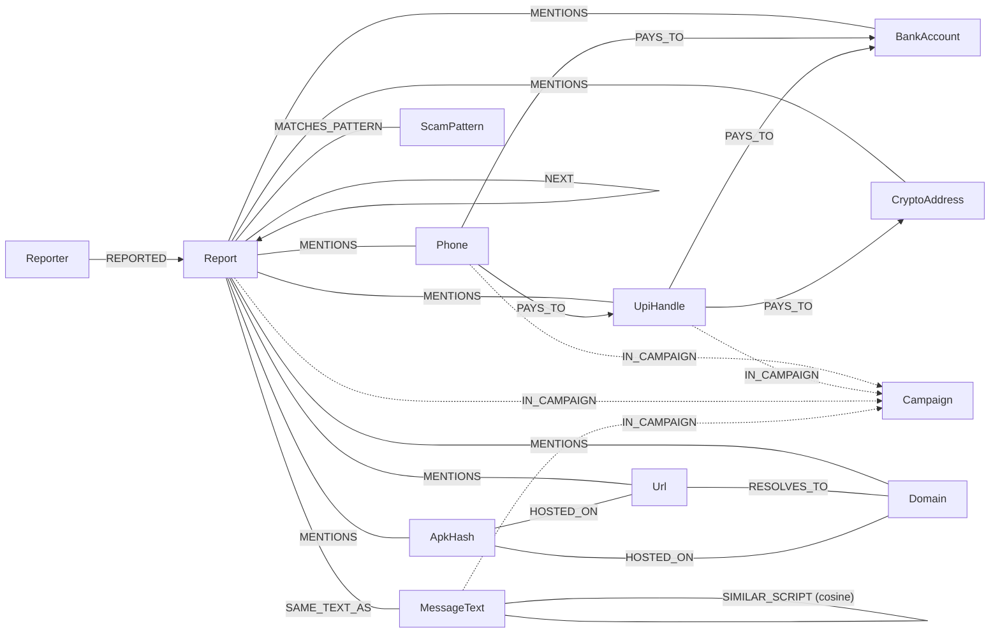

# JAAL on TigerGraph

JAAL's engine is one shared fraud graph. Every check from every device asks it
"is this part of a known ring?" and every report makes it denser. This folder
holds that graph on TigerGraph 4.x / Savanna: the schema, six online queries,
the batch ring detection, loaders, the Savanna setup, and a measured
TigerGraph-vs-Postgres receipt.

```
schema.gsql              12 vertex types, 11 edge types, graph JAAL, TigerVector job
queries/                 jaal_vtype (subquery) + 6 online queries + 3 batch queries
gds/                     tg_wcc, tg_louvain from the official GDS library (pinned to JAAL)
install_all.gsql         create + INSTALL QUERY ALL in dependency order
loading_job.gsql         generated from load/common.mjs (TSV, one LOAD per edge pair)
load/                    export-to-csv, push-restpp, refresh-rings, fetch-gds, fixture.json
bench/                   blast radius: Postgres recursive CTE vs memory BFS vs TigerGraph
setup.md                 Savanna step by step, token, server env, GraphStudio screenshot
```

## Why a graph, and why TigerGraph

A scam in India is not one bad number. It is a ring: 40 SIMs, 6 UPI handles,
2 mule accounts, a lookalike domain, an APK, one script translated three times,
moving from Jamtara to Pune to Bengaluru in a fortnight. The question "is this
handle dangerous?" is really "how close is it to something already
corroborated?", and that is a traversal.

| # | Query | Question it answers | GSQL features doing the work | In SQL |
|---|---|---|---|---|
| 1 | `blast_radius(id_key, window_days)` | What is within 2 identifier hops of this, inside the window, and how far is the nearest confirmed node? | multi-hop `WHILE` traversal, `OrAccum @visited`, `MinAccum @hop`, in-query 21-day half-life decay on `e.ts` (`SumAccum @score`), `HeapAccum` top-50, hub guard | recursive CTE with no cross-iteration visited set: vertices are re-expanded at every depth they are reachable at (see bench) |
| 2 | `ring_of(id_key)` | Which ring is this in? Draw it (<= 40 nodes, hop 0/1/2). | community membership from GDS `tg_wcc` + `tg_louvain` (batch), BFS inside the community, identifier-to-identifier edges projected through Reports with `SetAccum @via`, `HeapAccum` pruning | Louvain does not exist in SQL; you would export to Python/networkx and import the labels back |
| 3 | `money_chokepoint(k)` | Which account / handle / wallet do the most distinct phones route money to? | `SetAccum<VERTEX>` distinct inbound sets over `reverse_PAYS_TO`, co-mention via 2-hop through Reports, **in-query PageRank** over the heterogeneous PAYS_TO subgraph (`@pr'` delta, `WHILE ... LIMIT 20`) | `COUNT(DISTINCT)` works; PageRank over 4 tables does not |
| 4 | `lookalike_domain(domain, threshold)` | Has a near-copy of this domain (`sbi-kyc-update.in` vs `sbi-kyc-updates.in`) been reported? | 3-shingle Jaccard written with GSQL string functions: `substr` / `instr` / `length` in a `FOREACH ... RANGE`, `SetAccum<STRING>` per vertex | `pg_trgm` can do this one well; it is in the graph so the match can feed the ring |
| 5 | `script_similarity(text_key, k)` | Does this message read like a confirmed ring's script, even with brand-new identifiers? | **hybrid TigerVector search**: graph filter (MessageText `-IN_CAMPAIGN->` confirmed Campaign) as `candidate_set`, then `vectorSearch()` over a 256-d COSINE HNSW attribute, `distance_map` | pgvector can rank, but the candidate set is itself a graph query |
| 6 | `spread_map(campaign_id)` | How did the ring move across cities over time? | `NEXT` temporal edges, `MapAccum<STRING, MinAccum<DATETIME>>` first sighting per city, `HeapAccum` ordering | a window-function query; easy in SQL, included so the map comes from the same store |

The honest version of the pitch is in `bench/README.md`. At 4 hops on sparse
data, a well-indexed Postgres answers blast radius in under 1 ms. It degrades
with how much of the graph is reachable: p95 308 ms at 8 hops on the dense set,
against 0.3 ms for a plain BFS on the same data, both measured. What SQL cannot
do in place is the rest of the table: community detection, PageRank over mixed
vertex types, and vector search filtered by graph structure, all over the same
edges, all in one round trip.

## Schema



* **Primary ids are canonical keys** from `shared/extract.js`, in the form
  `type:value`: `upi:refund.desk@ybl`, `phone:+919812300001`,
  `report:<id>`, `reporter:<salted hash>`, `text:<hash>`,
  `campaign:<server id>` or `ring:<anchor key>`. The server never translates
  ids.
* **Every vertex type has the same common attributes**: `value, state,
  report_count, first_seen, last_seen, source, trust, city, wcc_id,
  community_id`. Heterogeneous traversals can read `v.state` without
  per-type branching. Type-specific extras: Report `ts, surface, verdict,
  lang`; Reporter `cluster`; BankAccount `ifsc`; CryptoAddress `chain`;
  Campaign `name, pattern, size, cluster_count, anchor`; and so on.
* **Every edge has `ts DATETIME, weight FLOAT, decayed FLOAT`**. Online queries
  compute decay from `ts` themselves. `decayed` is only written by
  `refresh_decay`, for Louvain.
* **`MessageText.embedding`**: `VECTOR ATTRIBUTE (DIMENSION=256, METRIC="COSINE")`,
  added by a global schema change job, TigerGraph 4.2+. 256 matches the
  server's hashed n-gram embedding (`a.vec` in its snapshot). If one side
  changes the dimension, the other has to change too.
* Undirected edges: MENTIONS, MATCHES_PATTERN, RESOLVES_TO, HOSTED_ON,
  SAME_TEXT_AS, SIMILAR_SCRIPT. These are walked by `tg_wcc` / `tg_louvain`.
  Directed edges with a reverse: REPORTED, PAYS_TO, NEXT, IN_CAMPAIGN.
* **Poisoning defences in the graph itself.** `REPORTED` is never a
  community edge, so one reporter cannot glue rings together. A Campaign is
  materialised only when a community has at least 3 undisputed scam reports
  from at least 2 independent `Reporter.cluster`s, with summed trust above a
  threshold. Disputed reports are excluded everywhere.

## Ring detection (batch)

`load/refresh-rings.mjs` (setup.md step 7) runs these steps over REST++, on a
schedule:

1. `refresh_decay(window_days)` sets `e.decayed = weight * 0.5^(age/21d)`
   inside the window and 1e-6 outside.
2. `tg_wcc(v_type_set, {MENTIONS, PAYS_TO, reverse_PAYS_TO, RESOLVES_TO, HOSTED_ON, SAME_TEXT_AS}, result_attribute="wcc_id")`
   gives hard-linked entities.
3. `tg_louvain(v_type_set, <same> + SIMILAR_SCRIPT, weight_attribute="decayed", result_attribute="community_id")`
   gives campaigns. The vertex set excludes Reporter and ScamPattern.
4. `materialize_campaigns()` applies the corroboration rule and upserts
   `Campaign "ring:<centre key>"` plus `IN_CAMPAIGN` edges. The id is stable
   across re-runs because Louvain labels a community with its centre vertex,
   and that vertex's key becomes the id. It also promotes members to
   `state = "confirmed"`.
5. `link_next()` chains each campaign's reports in time order with `NEXT`.

The server lane also mirrors its own campaigns as `campaign:<id>` with
`IN_CAMPAIGN` / `NEXT`. Both id styles resolve in `ring_of` / `spread_map`.

## Return shapes

Values in the examples are illustrative (fixture-shaped), not measurements.
Every query PRINTs one object, so `results[0]` (the server adapter does
`Object.assign({}, ...results)`). DATETIME values print as
`"YYYY-MM-DD hh:mm:ss"` in UTC. An empty `MinAccum<DATETIME>` prints
`"1970-01-01 00:00:00"`. Treat that as null.

### `blast_radius(STRING id_key, INT window_days = 90, INT max_hops = 4, INT hub_degree = 5000)`

```json
{
  "found": true,
  "center": "upi:refund.desk@ybl",
  "vertex_type": "UpiHandle",
  "window_days": 90,
  "reports_in_window": 12,
  "identifiers_reached": 9,
  "by_type": { "UpiHandle": 2, "Phone": 5, "BankAccount": 1, "MessageText": 1 },
  "hops_to_confirmed": 0,
  "confirmed_within_2_hops": 4,
  "first_seen": "2026-10-03 09:10:00",
  "last_seen": "2026-10-26 19:55:00",
  "campaigns": ["ring:upi:refund.desk@ybl"],
  "top": [ { "id": "phone:+919812300001", "vtype": "Phone", "hop": 1, "score": 0.42, "reports": 2, "state": "confirmed" } ]
}
```

* `hop` counts identifier hops. Passing through a Report is free, so
  `max_hops = 4` edge hops equals identifier hop 2.
* `hops_to_confirmed = -1` means no confirmed vertex was reached.
* `confirmed_within_2_hops` counts confirmed identifiers. The memory engine
  counts confirmed reports, and the adapter notes the difference.
* `score` is the decayed evidence reaching that vertex:
  `sum(score(parent) * e.weight * 0.5^(age_days/21))` over the BFS layer that
  first reached it.
* `identifiers_reached + reports_in_window` = everything reached, seed included.
  The benchmark cross-checks exactly this number.

### `ring_of(STRING id_key, INT max_nodes = 40)`

```json
{
  "found": true,
  "center": "upi:refund.desk@ybl",
  "campaign_id": "ring:upi:refund.desk@ybl",
  "campaign": [ { "v_id": "ring:upi:refund.desk@ybl", "v_type": "Campaign",
                  "attributes": { "name": "...", "pattern": "digital_arrest", "size": 9, "report_count": 5,
                                  "cluster_count": 4, "state": "confirmed", "first_seen": "...", "last_seen": "...", "anchor": "..." } } ],
  "nodes": [ { "id": "upi:refund.desk@ybl", "kind": "upi", "label": "refund.desk@ybl", "hop": 0, "reports": 2, "confirmed": true } ],
  "edges": [ { "src": "phone:+919812300001", "dst": "upi:refund.desk@ybl", "etype": "PAYS_TO" },
             { "src": "phone:+919812300002", "dst": "bank_account:50100123456789", "etype": "CO_REPORTED" } ]
}
```

To get the SPEC `Ring`, map `kind → type`, `src → source`, `dst → target`,
`etype → type`. Field names avoid the GSQL keywords `TYPE` and `TARGET`.
`CO_REPORTED` is a projected edge: two identifiers mentioned in the same
report. `id_key` may also be a campaign id. In that case the centre is the
member with the most reports. `found: false` means no campaign was found.

### `money_chokepoint(INT k = 10, INT window_days = 365)`

```json
{
  "chokepoints": [ { "id": "bank_account:50100123456789", "kind": "bank_account", "label": "50100123456789",
                     "inbound_phones": 1, "inbound_handles": 2, "co_reported_phones": 3, "inbound_total": 5,
                     "pagerank": 0.61, "reports": 3, "state": "confirmed", "campaign": "ring:upi:refund.desk@ybl" } ],
  "pagerank_iterations": 7
}
```

Ranked by `inbound_total` (= |inbound phones ∪ co-reported phones| + inbound
handles) DESC, then `pagerank` DESC. `pagerank` is 0 for a receiver with no
`PAYS_TO` edge.

### `lookalike_domain(STRING domain, FLOAT threshold = 0.4, INT k = 20)`

```json
{ "query": "sbi-kyc-update.in", "shingles": 15, "scanned": 19309,
  "matches": [ { "id": "domain:sbi-kyc-updates.in", "label": "sbi-kyc-updates.in", "jaccard": 0.875, "shared": 14, "reports": 3, "state": "confirmed" } ] }
```

Accepts `domain:x` or `x`. The query domain itself is excluded. This query is
a scan over all Domain vertices, `O(|Domain| × length)`, and the file says so.
The graph-native upgrade is a `Shingle` vertex with `HAS_SHINGLE` edges,
written at upsert time, which turns it into a 2-hop traversal.

### `script_similarity(STRING text_key, INT k = 10, BOOL confirmed_only = TRUE)` / `script_similarity_vec(LIST<FLOAT> query_vector, ...)`

```json
{ "found": true, "query": "text:da01", "candidates": 41,
  "matches": [ { "id": "text:da02", "label": "CBI officer speaking, ...", "distance": 0.09, "similarity": 0.91,
                 "reports": 2, "state": "confirmed", "campaign": "ring:upi:refund.desk@ybl" } ] }
```

`script_similarity_vec` returns the same shape without `found` / `query`. Use
`_vec` for a message that is not in the graph yet: POST
`{"query_vector":[...256 floats], "k":10}` to `/restpp/query/JAAL/script_similarity_vec`.

### `spread_map(STRING campaign_id, INT window_days = 365, INT max_hops = 200)`

```json
{ "found": true, "campaign_id": "campaign:259", "reports": 48,
  "cities": [ { "city": "Mumbai", "first_seen": "2026-10-21 05:11:16", "reports": 9 } ],
  "hops":   [ { "from_city": "Mumbai", "to_city": "Pune", "ts": "2026-10-23 01:46:54", "gap_hours": 44.6 } ] }
```

`cities` is ordered by `first_seen`. SPEC `[{city, firstSeen, count}]` maps
`reports → count`.

### Batch queries

| query | prints |
|---|---|
| `refresh_decay(window_days)` | `{edge_visits, live_visits, window_days}` (undirected edges are counted from both ends) |
| `materialize_campaigns(min_reports=3, min_clusters=2, min_trust=1.0, min_size=2, promote=true)` | `{campaigns, members_linked, communities_seen}` |
| `link_next(window_days=365)` | `{next_edges}` |
| `jaal_vtype(id_key)` (subquery) | the vertex type name for a key prefix; unknown prefixes map to `Campaign` |

## How the server uses it

`server/src/graph/tigergraph.js` (server lane) calls these queries over REST++:
`GET {TG_HOST}/restpp/query/JAAL/<name>?<params>` with a bearer token. It maps
the shapes above through `fromTG.*` and mirrors its writes with
`POST /restpp/graph/JAAL` upserts. The memory engine stays authoritative and
answers whenever TigerGraph times out, so the demo never depends on the
network. Set `GRAPH_BACKEND=tigergraph` + `TG_HOST` + `TG_TOKEN` (or
`TG_SECRET`). See setup.md step 8.

**One integration note for the server lane:** the memory engine stores
`Report -MENTIONS-> ScamPattern`. In this schema that link is
`MATCHES_PATTERN`, so that pattern hubs stay out of Louvain. `load/` converts
it automatically. The live mirror (`mirror()` in `tigergraph.js`) should send
`E.MENTIONS` edges whose target is a `ScamPattern` as `MATCHES_PATTERN`.
Otherwise REST++ will not accept those particular edges, because the
(Report, ScamPattern) pair is not declared for MENTIONS.

## Snapshot contract (load/)

`export-to-csv.mjs` and `push-restpp.mjs` read `server/data/graph.json` when
it exists, otherwise `load/fixture.json`. A path argument overrides both.
`load/common.mjs#normalizeSnapshot` accepts:

* **the server's memory-engine snapshot** (verified against the real file:
  23,191 vertices, 2,413 edges, 0 warnings):
  `{ version, savedAt, vertices: [{ id, type, first, last, checks, src: [], a: {...} }], edges: [[type, source, target, ts, first, n, weight, src]] }`
  It reads `a.trust`, `a.city`, `a.ts`, `a.verdict`, `a.surface`, `a.lang`,
  `a.text`, `a.vec` (embedding), `a.ifsc` and `a.net` (reporter cluster).
* **object forms**:
  `{ vertices|nodes: [...] | {id: {...}}, edges: [{type, from|source, to|target, ts, weight}] }`
* **higher-level collections**, as in `fixture.json`:
  `reports: [{id, ts, reporter, identifiers: [key | {type,value}], textKey, city, ...}]`,
  `reporters`, `texts`, `campaigns: [{id, members: [...]}]`

Vertex types come from `type` (TigerGraph name or extract.js type) or from the
key prefix. Edge endpoints are swapped into schema order when needed, and
`report_count` / `first_seen` / `last_seen` / `state` are derived from the
evidence edges when the snapshot does not carry them. Texts without an
embedding get a deterministic 256-d hashed trigram vector as a fallback. When
the snapshot has `a.vec`, the server's own vector is used.

## Verified vs written

* **Run:** `export-to-csv.mjs` and `push-restpp.mjs --dry-run` on both the
  fixture and the live `server/data/graph.json`; `gen-loading-job.mjs`;
  `fetch-gds.mjs`; the full Postgres and memory benchmark (real numbers in
  `bench/`).
* **Written, not executed:** all GSQL. There was no TigerGraph instance
  during development: the Docker daemon was down, and Savanna needs an
  account. The GSQL follows the 4.x docs for syntax: vector schema change,
  `vectorSearch` options, `to_vertex_set`, string functions, multi-pair edges,
  accumulators, and the GDS signatures fetched from the official repo. Expect
  to fix small compile errors on first install. Version-dependent pieces are
  marked in the files: TigerVector (4.2+), and reading a vector attribute in
  `POST-ACCUM` in `script_similarity`. If that read is rejected on your
  build, use `script_similarity_vec`.
